# TUAB classical machine-learning baselines — detailed research notes (v1)

## Status and scope

This document summarizes the methods and recorded outputs of `notebooks/04-TUAB-EEG-ML-Baselines.ipynb`. It is designed as source material for the machine-learning methods, results, and discussion sections of the research paper.

The authoritative completed development run is:

```text
reports/ml_baselines/20261022T223917Z/
```

The earlier run `20261022T202153Z` was incomplete and must not be used for reporting. All 23 code cells in the completed notebook run executed sequentially without a stored exception. The final evaluation remained locked (`RUN_FINAL_EVALUATION = False`), so every result in this document is a cross-validation or validation result—not a final test result.

## Research objective

The analysis evaluates whether recording-level engineered EEG features distinguish normal from abnormal TUAB recordings and whether excluding preprocessing-QC-suspect epochs changes predictive performance or model interpretation.

Two feature representations are compared:

- **FE-All:** 1,152 predictors aggregated over every preprocessed epoch, including epochs marked `SUSPECT`.
- **FE-QC:** the same 1,152 predictors and aggregation procedures, calculated only from epochs marked as accepted by preprocessing QC.

The paired experiment changes only the epoch inclusion policy. It does not change feature definitions, model families, cross-validation folds, or search budgets.

## Cohorts and patient independence

| Experiment | Train | Validation | Evaluation | Total |
|---|---:|---:|---:|---:|
| Primary paired FE-All/FE-QC | 2,165 | 538 | 276 | 2,979 |
| Secondary complete FE-All | 2,173 | 544 | 276 | 2,993 |

The 14 recordings with no QC-accepted epochs are excluded from the primary paired comparison but retained in the complete FE-All experiment.

Patient-independent splitting means that no patient occurs in more than one predefined split:

| Split comparison | Overlapping patients |
|---|---:|
| Train vs validation | 0 |
| Train vs evaluation | 0 |
| Validation vs evaluation | 0 |

It does **not** mean that every recording within a split belongs to a different patient. The paired validation cohort contains:

- 538 recordings.
- 410 unique patients.
- 86 patients contributing more than one recording.
- A maximum of 9 recordings from one patient.
- 12 patients with both normal and abnormal recording labels.

Consequently, performance is defined at the recording level, while confidence intervals resample whole patient clusters. A single patient-level classification metric is not reported because a unique patient-level target is undefined for patients with recordings from both classes.

## Predictors and excluded metadata

All models use the same 1,152 CAR-derived predictors:

- 912 channel-level features.
- 240 regional features.
- Spectral, temporal, amplitude, Hjorth, and regional summaries.
- Median and IQR recording-level aggregations.

The following fields are never used as predictors:

- `filepath`
- `patient_id`
- `label`
- `split`
- `total_epochs`
- `accepted_epochs`
- `accepted_fraction`

QC coverage is used only for post-prediction sensitivity analysis.

## Models and leakage controls

| Model | Pipeline | Search space |
|---|---|---|
| Dummy | Median imputation → prior classifier | No tuned parameters |
| Logistic Regression | Median imputation → standardization → L2 logistic regression | `C ∈ {0.01, 0.1, 1, 10}` |
| RBF SVM | Median imputation → standardization → probabilistic RBF SVM | `C ∈ {0.1, 1, 10}`; `gamma ∈ {scale, 0.001, 0.01}` |
| Random Forest | Median imputation → balanced random forest | 200/400 trees; depth unrestricted/10/20; minimum leaf 1/3/5 |
| XGBoost | Median imputation → histogram XGBoost | 200/400 trees; depth 3/5; learning rate 0.03/0.1; subsample 0.8/1.0 |

All learned preprocessing is contained in scikit-learn pipelines. Five-fold `StratifiedGroupKFold` is applied within training with `patient_id` as the group, random seed 42, and identical fold indices for paired FE-All and FE-QC experiments. Hyperparameters are selected by mean CV ROC-AUC.

## Selected hyperparameters

| Representation | Model | Selected configuration |
|---|---|---|
| FE-All | Logistic Regression | `C=0.01` |
| FE-All | RBF SVM | `C=10`, `gamma=scale` |
| FE-All | Random Forest | 200 trees, unrestricted depth, minimum leaf 3 |
| FE-All | XGBoost | 400 trees, depth 5, learning rate 0.03, subsample 0.8 |
| FE-QC | Logistic Regression | `C=0.01` |
| FE-QC | RBF SVM | `C=1`, `gamma=scale` |
| FE-QC | Random Forest | 400 trees, depth 20, minimum leaf 5 |
| FE-QC | XGBoost | 400 trees, depth 5, learning rate 0.03, subsample 0.8 |

The different selected SVM and Random Forest configurations show that QC screening changes the effective feature distribution enough to alter model regularization or complexity preferences.

## Patient-grouped cross-validation results

Values are mean ± standard deviation across five patient-grouped training folds.

| Representation | Model | ROC-AUC | Balanced accuracy |
|---|---|---:|---:|
| FE-All | Dummy | 0.5000 ± 0.0000 | 0.5000 ± 0.0000 |
| FE-All | Logistic Regression | 0.9018 ± 0.0188 | 0.8256 ± 0.0190 |
| FE-All | RBF SVM | 0.9103 ± 0.0117 | 0.8448 ± 0.0199 |
| FE-All | Random Forest | 0.9072 ± 0.0153 | 0.8303 ± 0.0241 |
| FE-All | XGBoost | **0.9219 ± 0.0103** | **0.8458 ± 0.0138** |
| FE-QC | Dummy | 0.5000 ± 0.0000 | 0.5000 ± 0.0000 |
| FE-QC | Logistic Regression | 0.9102 ± 0.0173 | 0.8339 ± 0.0133 |
| FE-QC | RBF SVM | 0.9147 ± 0.0088 | 0.8379 ± 0.0173 |
| FE-QC | Random Forest | 0.9090 ± 0.0167 | 0.8266 ± 0.0270 |
| FE-QC | XGBoost | **0.9210 ± 0.0154** | **0.8424 ± 0.0151** |

Cross-validation suggests that all four trained classifiers substantially outperform the prior baseline. XGBoost obtained the highest mean CV ROC-AUC for both representations, although the difference from RBF SVM was modest relative to fold variability.

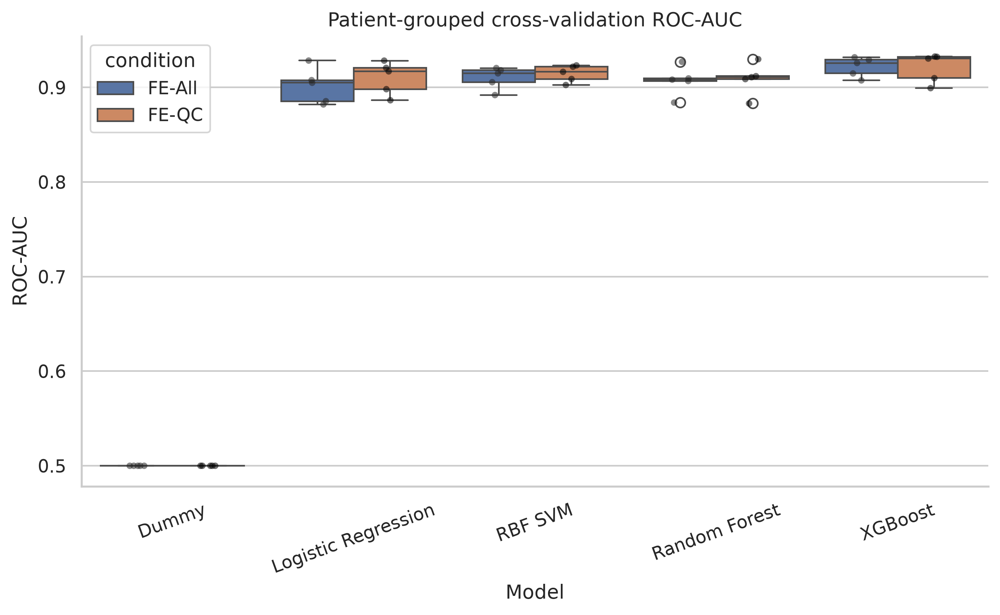

**Figure 1. Patient-grouped cross-validation ROC-AUC.** Points represent patient-grouped folds. FE-All and FE-QC use identical paired recordings and fold assignments.

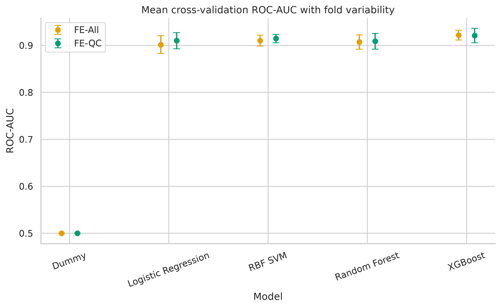

**Figure 2. Mean cross-validation ROC-AUC and between-fold standard deviation.** Error bars show fold variability, not population confidence intervals.

## Paired validation performance

The primary validation comparison uses the same 538 recordings from 410 patients for both feature representations.

| Representation | Model | ROC-AUC | Balanced accuracy | Sensitivity | Specificity | Precision | F1 |
|---|---|---:|---:|---:|---:|---:|---:|
| FE-All | Dummy | 0.5000 | 0.5000 | 1.0000 | 0.0000 | 0.4944 | 0.6617 |
| FE-All | Logistic Regression | 0.9041 | 0.8380 | 0.8120 | 0.8640 | 0.8538 | 0.8324 |
| FE-All | RBF SVM | 0.9079 | 0.8303 | 0.7782 | 0.8824 | 0.8661 | 0.8198 |
| FE-All | Random Forest | 0.8939 | 0.8283 | 0.7632 | 0.8934 | 0.8750 | 0.8153 |
| FE-All | XGBoost | 0.9063 | 0.8318 | 0.7481 | 0.9154 | 0.8964 | 0.8156 |
| FE-QC | Dummy | 0.5000 | 0.5000 | 1.0000 | 0.0000 | 0.4944 | 0.6617 |
| FE-QC | Logistic Regression | 0.8618 | 0.8242 | 0.7293 | 0.9191 | 0.8981 | 0.8050 |
| FE-QC | RBF SVM | **0.9183** | 0.8391 | 0.7481 | **0.9301** | **0.9128** | 0.8223 |
| FE-QC | Random Forest | 0.8980 | **0.8398** | 0.8045 | 0.8750 | 0.8629 | **0.8327** |
| FE-QC | XGBoost | 0.9048 | 0.8253 | **0.8271** | 0.8235 | 0.8209 | 0.8240 |

The highest observed validation ROC-AUC was 0.9183 for the FE-QC RBF SVM. No representation dominated across every model or metric.

### Critical threshold-calibration qualification

Validation ROC-AUC is threshold-independent. In contrast, the notebook selected each Youden threshold from the validation labels and then calculated balanced accuracy, sensitivity, specificity, precision, F1, and the confusion matrix on those same validation recordings. These threshold-dependent validation metrics are therefore **threshold-calibrated descriptive estimates**, not unbiased estimates of generalization performance.

The locked final-evaluation design avoids this reuse: it applies validation-selected thresholds to evaluation recordings. However, final evaluation was not executed. Until it is run, the manuscript should emphasize ROC-AUC and label validation threshold-dependent metrics accurately.

For an independent validation balanced accuracy, thresholds should be learned from patient-grouped out-of-fold training predictions and applied unchanged to validation.

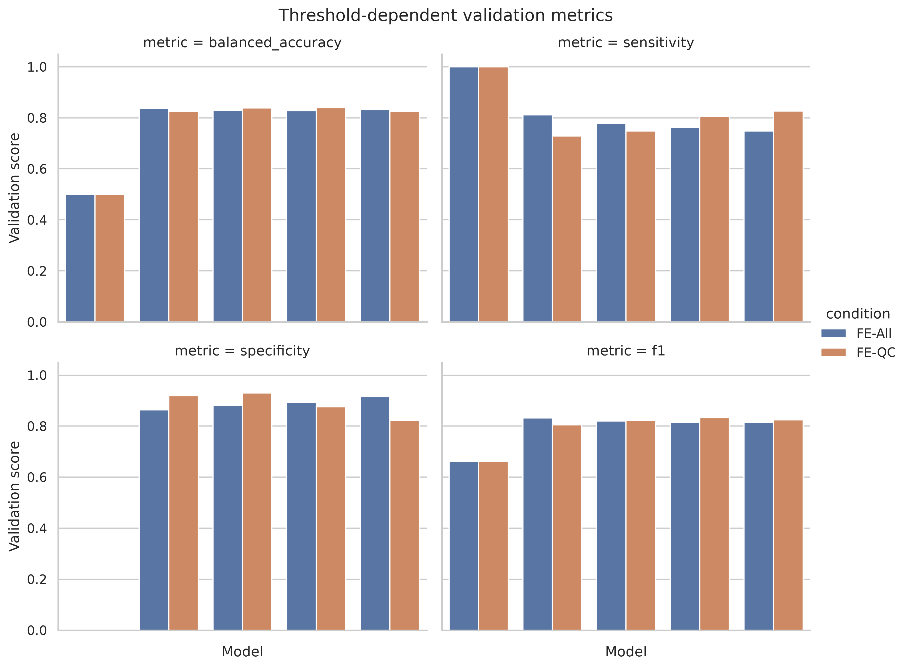

**Figure 3. Threshold-dependent validation metrics.** These values use thresholds calibrated on the displayed validation cohort and must be interpreted descriptively.

## Patient-clustered uncertainty

Separate 95% confidence intervals were estimated by 2,000 bootstrap replicates that resampled whole patients while retaining all their recordings and recording-level labels.

| Representation | Model | ROC-AUC | Patient-clustered 95% CI |
|---|---|---:|---:|
| FE-All | Logistic Regression | 0.9041 | 0.8751–0.9300 |
| FE-All | RBF SVM | 0.9079 | 0.8802–0.9324 |
| FE-All | Random Forest | 0.8939 | 0.8629–0.9235 |
| FE-All | XGBoost | 0.9063 | 0.8790–0.9324 |
| FE-QC | Logistic Regression | 0.8618 | 0.8196–0.9013 |
| FE-QC | RBF SVM | 0.9183 | 0.8921–0.9417 |
| FE-QC | Random Forest | 0.8980 | 0.8680–0.9267 |
| FE-QC | XGBoost | 0.9048 | 0.8756–0.9312 |

Because separate confidence intervals do not test paired differences, a paired patient-cluster bootstrap was additionally calculated using the same resampled patients for FE-All and FE-QC in every replicate.

| Model | ΔROC-AUC (QC − All) | Paired patient-clustered 95% CI | Interpretation |
|---|---:|---:|---|
| Logistic Regression | −0.0424 | −0.0807 to −0.0058 | QC reduction supported in this validation sample |
| RBF SVM | +0.0104 | −0.0047 to +0.0259 | Small increase; interval includes zero |
| Random Forest | +0.0041 | −0.0050 to +0.0150 | Small increase; interval includes zero |
| XGBoost | −0.0015 | −0.0102 to +0.0075 | Essentially unchanged; interval includes zero |

Only Logistic Regression showed a paired interval excluding zero, and the direction favored FE-All. The small observed RBF SVM and Random Forest improvements are not statistically supported by these intervals. These are validation analyses and were not adjusted for multiple model comparisons.

The saved RBF SVM comparison is available at:

```text
reports/ml_baselines/20261022T223917Z/comparisons/rbf_svm_patient_clustered_auc_comparison.csv
```

## FE-All versus FE-QC comparison

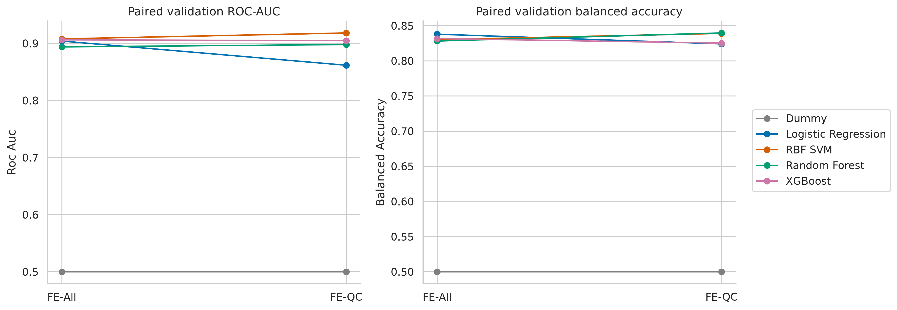

**Figure 4. Paired validation changes from FE-All to FE-QC.** Connecting lines show model-specific direction of change on identical validation recordings. Balanced-accuracy changes use validation-calibrated thresholds.

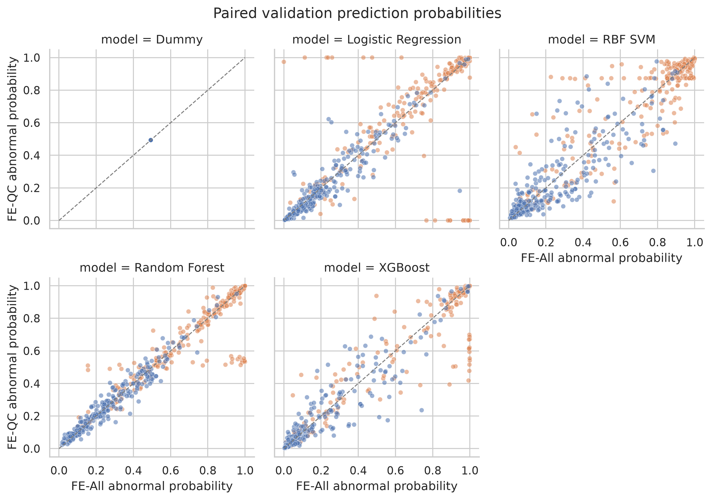

**Figure 5. Recording-level FE-All and FE-QC probabilities.** Departures from the diagonal identify recordings whose predicted abnormality probability changed after QC screening. Probability changes do not by themselves establish that one representation is more clinically valid.

Overall, QC screening did not uniformly improve classification:

- RBF SVM showed the largest positive ROC-AUC difference, but its paired interval included zero.
- Random Forest showed a small, uncertain increase.
- XGBoost was essentially unchanged.
- Logistic Regression performed materially worse after QC screening.

This model dependence argues against treating FE-QC as automatically superior.

## QC-coverage sensitivity

Most validation recordings retained more than 90% of their epochs. Low-coverage groups were small:

| Accepted-epoch coverage | Validation recordings |
|---|---:|
| ≤25% | 5 |
| >25–50% | 9 |
| >50–75% | 29 |
| >75–90% | 85 |
| >90–100% | 410 |

Because the two lowest-coverage groups contain only 5 and 9 recordings, their error percentages are highly unstable and should not support strong conclusions. The plots are descriptive rather than inferential.

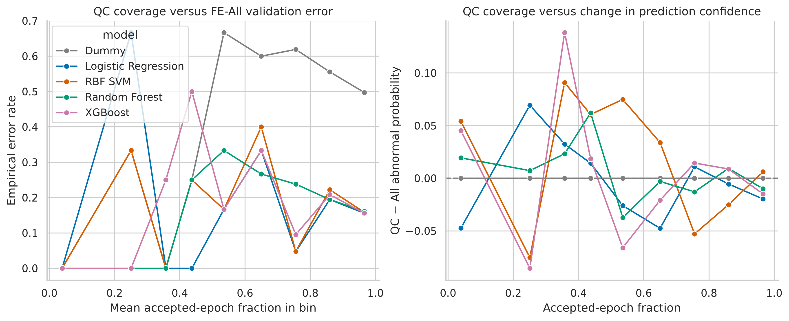

**Figure 6. QC coverage, FE-All error rate, and FE-QC probability changes.** Curves show empirical coverage-bin summaries by model. QC coverage was not supplied to any classifier.

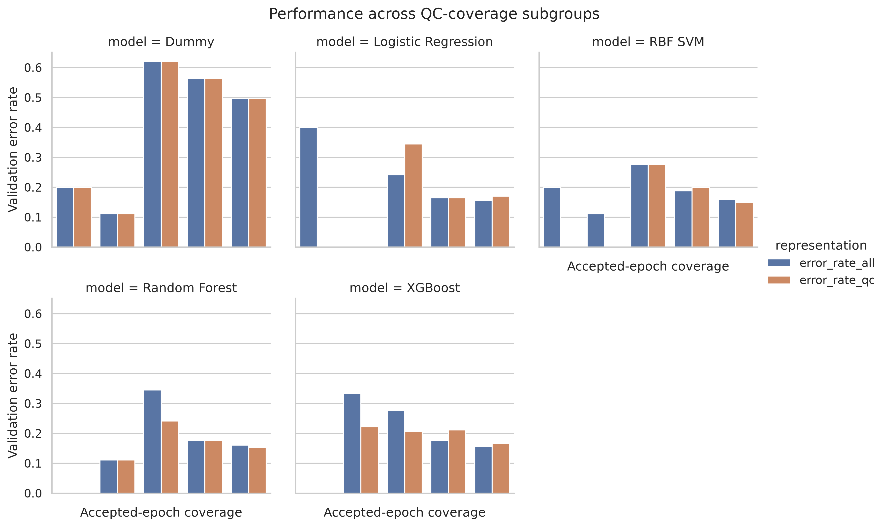

**Figure 7. Validation error rates across QC-coverage groups.** Subgroup counts must accompany this figure because low-coverage estimates are based on very few recordings.

## Secondary complete FE-All cohort

The complete-cohort experiment includes all 2,993 recordings and must be reported separately from the paired experiment.

| Model | Validation ROC-AUC | Validation balanced accuracy |
|---|---:|---:|
| Dummy | 0.5000 | 0.5000 |
| Logistic Regression | 0.8974 | 0.8324 |
| RBF SVM | **0.9084** | 0.8327 |
| Random Forest | 0.8954 | 0.8235 |
| XGBoost | 0.9074 | **0.8340** |

The complete FE-All results are close to the paired FE-All results, suggesting that exclusion of the 14 zero-accepted recordings did not materially change aggregate validation performance. This is descriptive, not a formal equivalence test.

## Feature importance

Permutation importance was calculated on validation data with five repetitions for Logistic Regression, RBF SVM, Random Forest, and XGBoost. The complete table contains 9,216 rows: 1,152 features × 4 models × 2 representations.

Selected leading features illustrate substantial model and representation dependence:

| Representation | Model | Selected leading permutation feature | Mean ROC-AUC decrease |
|---|---|---|---:|
| FE-All | Logistic Regression | Cz theta/alpha ratio IQR | 0.00491 |
| FE-All | RBF SVM | Cz theta/alpha ratio IQR | 0.00435 |
| FE-All | Random Forest | T3 median theta absolute power | 0.00210 |
| FE-All | XGBoost | T3 median delta absolute power | 0.00541 |
| FE-QC | Logistic Regression | Pz spectral entropy IQR | 0.04256 |
| FE-QC | RBF SVM | C4 theta relative-power IQR | 0.01309 |
| FE-QC | Random Forest | T3 median theta absolute power | 0.00212 |
| FE-QC | XGBoost | T3 median delta absolute power | 0.00621 |

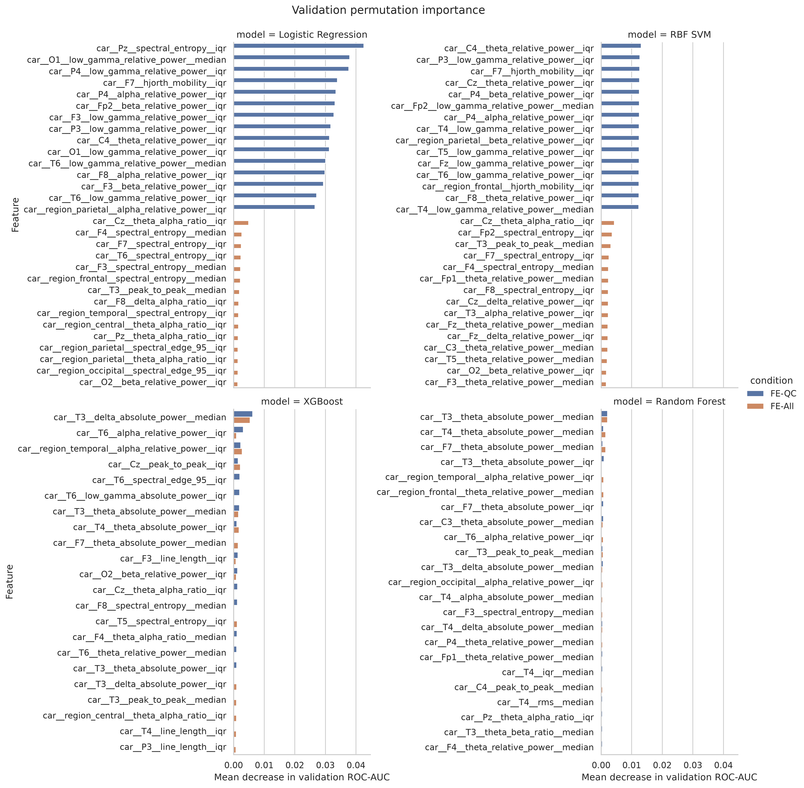

**Figure 8. Leading validation permutation importances.** Importance is the change in ROC-AUC after shuffling one predictor. Correlated EEG predictors can substitute for one another; rankings must not be interpreted as causal biomarkers.

Across every model and representation, summed positive permutation importance was largest for spectral features. This does not prove that spectral physiology is intrinsically more important because summed importance depends on feature count, correlation, scale of model reliance, and the grouping definition.

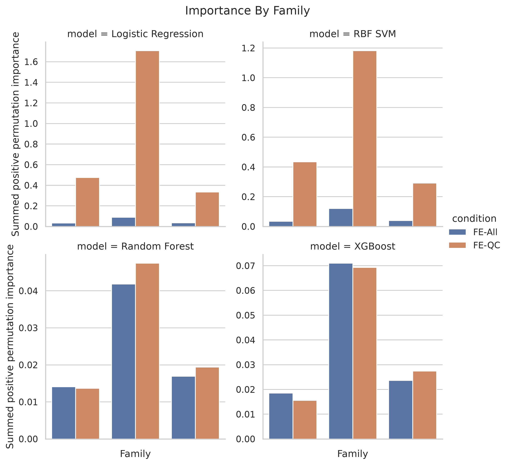

**Figure 9. Permutation importance grouped by feature family.** Regional predictors supplement channel features and are not independent observations of anatomy.

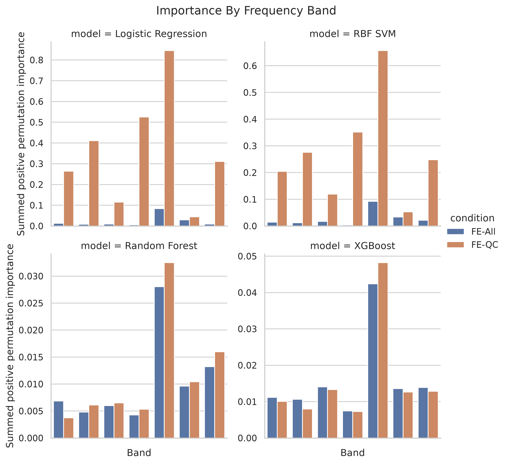

**Figure 10. Importance grouped by frequency category.** Multi-band power ratios are kept separate from single-band power features to avoid assigning a ratio to only one constituent band.

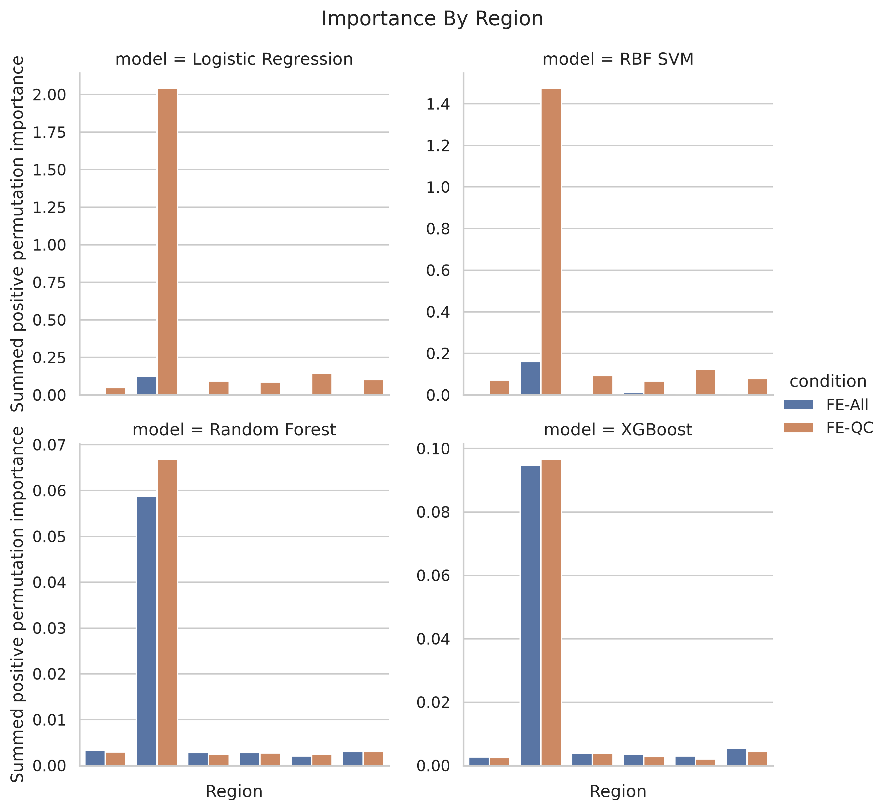

**Figure 11. Importance grouped by regional representation.** These results describe predictive reliance and do not establish clinical localization.

## Regional ablation

Regional ablation removes the corresponding channel-level predictors and the 48 regional-summary predictors, refits the selected estimator on training data, and evaluates it on validation.

| Representation | Model | Largest performance decrease | ΔROC-AUC |
|---|---|---|---:|
| FE-All | Logistic Regression | Remove frontal | −0.0145 |
| FE-All | XGBoost | Remove frontal | −0.0061 |
| FE-QC | Logistic Regression | Remove central | −0.0242 |
| FE-QC | XGBoost | Remove frontal | −0.0127 |

Removing occipital predictors slightly increased validation ROC-AUC in all four displayed conditions (+0.0033 to +0.0136). This may indicate redundancy, noise, or finite-sample variation; it does not establish that occipital activity is uninformative.

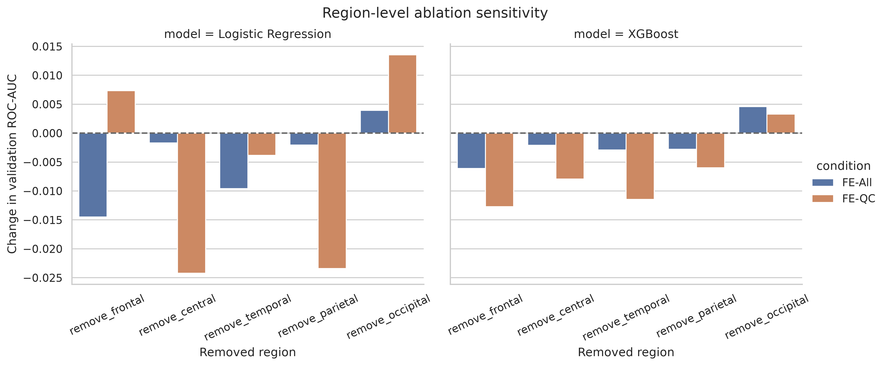

**Figure 12. Change in validation ROC-AUC after regional predictor removal.** Ablation results are development analyses on one validation cohort and require confirmation on untouched data.

## Computational observations

Approximate paired grid-search durations were:

| Model | FE-All | FE-QC |
|---|---:|---:|
| Dummy | 2 s | 1 s |
| Logistic Regression | 21 s | 18 s |
| RBF SVM | 161 s | 156 s |
| Random Forest | 243 s | 230 s |
| XGBoost | 638 s | 636 s |

Permutation importance was the longest interpretability step. Model files, search tables, predictions, metrics, provenance, and figures were saved under the timestamped run directory.

## Paper-ready Methods text

> Classical machine-learning baselines were trained using 1,152 recording-level EEG predictors derived from 19-channel common-average-referenced epochs. Two matched feature representations were evaluated: FE-All, which aggregated features over all preprocessed epochs, and FE-QC, which aggregated the same features only over epochs accepted by preprocessing quality control. The primary paired cohort contained 2,979 recordings, including 2,165 training, 538 validation, and 276 evaluation recordings. Patient-independent predefined splits were preserved, with no patient overlap among training, validation, and evaluation. Within the training split, hyperparameters were selected using five-fold stratified group cross-validation with patient identifier as the grouping variable and ROC-AUC as the selection metric. Median imputation and, where applicable, standardization were fitted within each training fold. Evaluated classifiers comprised a prior dummy baseline, L2-regularized logistic regression, an RBF support-vector machine, Random Forest, and XGBoost. Patient identifiers, file paths, split labels, and QC-coverage variables were excluded from predictors.

> Validation discrimination was assessed at the recording level. Because patients could contribute multiple recordings, ROC-AUC confidence intervals were estimated using 2,000 bootstrap replicates that resampled patients as clusters while retaining all recording-level outcomes. FE-All and FE-QC differences were evaluated with a paired patient-cluster bootstrap using the same resampled patients for both representations. Patient-level classification was not calculated because some patients had both normal and abnormal recording labels.

## Paper-ready Results text

> In five-fold patient-grouped cross-validation, mean ROC-AUC ranged from 0.902 to 0.922 for FE-All and from 0.909 to 0.921 for FE-QC across the four trained classifiers. XGBoost achieved the highest mean cross-validation ROC-AUC for FE-All (0.922 ± 0.010) and FE-QC (0.921 ± 0.015). On the paired validation cohort of 538 recordings from 410 patients, the highest observed ROC-AUC was obtained by the FE-QC RBF SVM (0.918; patient-clustered 95% CI 0.892–0.942), compared with 0.908 (95% CI 0.880–0.932) for its FE-All counterpart. The paired ROC-AUC difference was 0.010 (95% CI −0.005 to 0.026), providing insufficient evidence of an improvement after QC screening. QC effects were model dependent: Logistic Regression decreased by 0.042 (paired 95% CI −0.081 to −0.006), whereas Random Forest and XGBoost showed small differences whose intervals included zero.

## Paper-ready Discussion points

- All trained models exceeded the prior baseline, showing that the engineered EEG representation contains substantial abnormality-related information.
- QC screening did not provide a uniform performance benefit. Its effect depended on model family and regularization.
- FE-QC RBF SVM produced the highest observed validation ROC-AUC, but its paired improvement over FE-All was uncertain.
- Logistic Regression was sensitive to QC screening and performed significantly worse in the paired validation bootstrap, suggesting that removing suspect epochs changes the linear decision structure.
- Spectral predictors dominated summed permutation importance, but strong feature correlations prevent causal interpretation of individual rankings.
- Regional ablation showed model-dependent reliance, most consistently involving frontal predictors, but the analysis cannot establish anatomical localization.
- Low-QC-coverage subgroups were too small for firm subgroup conclusions.
- Evaluation results are still unavailable; all conclusions must be framed as development findings until the protocol is frozen and the locked evaluation is run.

## Limitations requiring explicit reporting

1. **No final evaluation yet.** The evaluation split remained untouched, so validation findings must not be called final test performance.
2. **Threshold reuse in validation.** Balanced accuracy and other threshold-dependent validation metrics use thresholds optimized on the same validation labels and are descriptive rather than unbiased.
3. **Repeated recordings per patient.** Recording observations are correlated within patients; patient-clustered uncertainty is therefore required.
4. **Mixed labels within patients.** Twelve paired-validation patients have both normal and abnormal recordings, preventing a unique patient-level target without an arbitrary rule.
5. **Multiple model comparisons.** Paired confidence intervals were not corrected for testing multiple models.
6. **Correlated predictors.** Coefficients and permutation importance can be unstable or diluted when predictors share information.
7. **Validation-based interpretation.** Feature importance and regional ablation were examined on validation and require confirmation.
8. **Small low-coverage groups.** The ≤25% and >25–50% groups contained only 5 and 9 validation recordings.
9. **Feature-to-sample ratio.** The 1,152 predictors are large relative to 2,165 paired training recordings, increasing overfitting risk despite regularization.
10. **QC selection effects.** Abnormal recordings had lower QC acceptance during feature auditing, so QC exclusion may remove clinical signal as well as artifact.

## Recommended next steps before final evaluation

1. Freeze the primary model and representation using the prespecified selection rule—not the most favorable isolated validation result.
2. Select classification thresholds from patient-grouped out-of-fold training predictions if unbiased validation balanced accuracy is required.
3. Prespecify the final threshold, chosen model configuration, confidence-interval method, and paired-comparison method.
4. Decide whether low-gamma predictors will be retained or evaluated through a training/validation-only sensitivity analysis.
5. Do not make further modelling choices after accessing evaluation labels.
6. Set `RUN_FINAL_EVALUATION = True` only after the protocol and analysis code are frozen.
7. Report recording-level evaluation ROC-AUC with patient-clustered confidence intervals and paired FE-All/FE-QC differences.

## Key artifacts

| Artifact | Location |
|---|---|
| All paired validation metrics | `reports/ml_baselines/20261022T223917Z/validation_results/metrics.csv` |
| Patient-clustered validation intervals | `reports/ml_baselines/20261022T223917Z/validation_results/recording_metrics_patient_clustered_ci.csv` |
| Paired FE-All/FE-QC metrics | `reports/ml_baselines/20261022T223917Z/comparisons/paired_validation_metric_differences.csv` |
| RBF SVM paired clustered-AUC table | `reports/ml_baselines/20261022T223917Z/comparisons/rbf_svm_patient_clustered_auc_comparison.csv` |
| Fold-level CV results | `reports/ml_baselines/20261022T223917Z/cv_results/best_candidate_fold_scores.csv` |
| Full-cohort validation metrics | `reports/ml_baselines/20261022T223917Z/validation_results/full_cohort_metrics.csv` |
| Permutation importance | `reports/ml_baselines/20261022T223917Z/feature_importance/validation_permutation_importance.parquet` |
| Grouped importance | `reports/ml_baselines/20261022T223917Z/feature_importance/grouped_importance.csv` |
| Regional ablation | `reports/ml_baselines/20261022T223917Z/feature_importance/regional_ablation.csv` |
| Run metadata | `reports/ml_baselines/20261022T223917Z/run_metadata.json` |

## Reporting checklist

- State clearly that these are development and validation results.
- Report 538 paired validation recordings from 410 unique patients.
- Use patient-clustered confidence intervals for recording-level metrics.
- Use paired patient-cluster resampling for FE-All versus FE-QC differences.
- Do not infer a significant RBF SVM improvement because its paired interval includes zero.
- Label validation balanced accuracy as threshold-calibrated and descriptive.
- Keep full-cohort and paired-cohort results separate.
- Avoid causal or clinical-localization claims from feature importance or ablation.
- Report low-coverage subgroup sizes beside subgroup results.
- Preserve the evaluation lock until every analysis choice is frozen.
