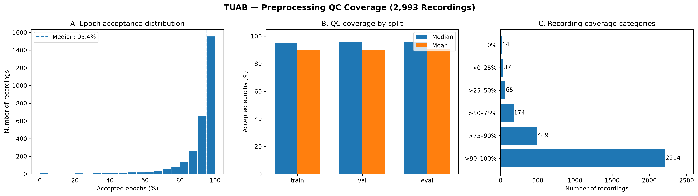
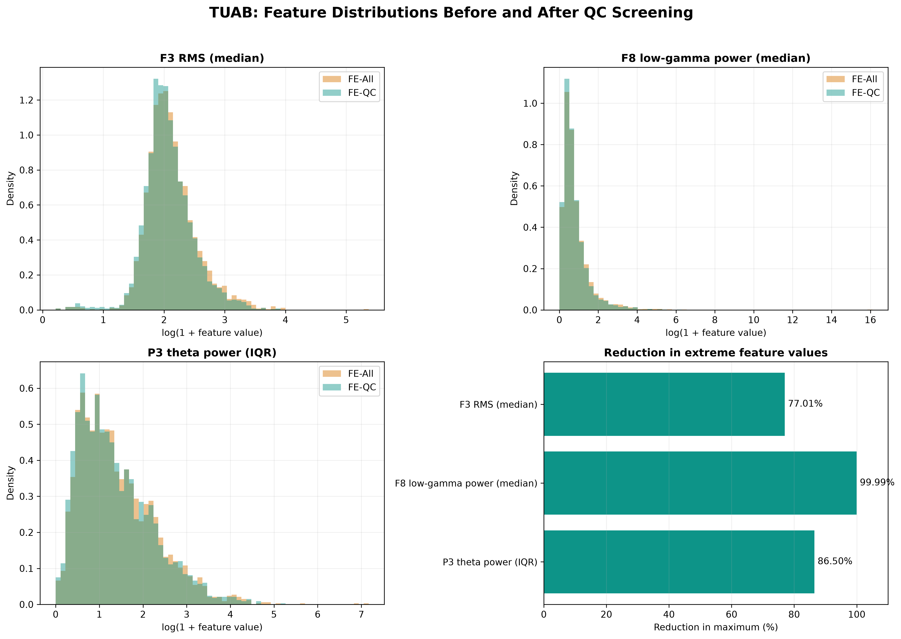

# Feature extraction: paper-ready notes from Notebook 03

## Scope

This note summarizes the methods, validation results, tables, and figures recorded in `notebooks/03-TUAB-EEG-Feature-Extraction.ipynb`. It is intended as source material for the feature-extraction section of the research paper. Values below were taken from the notebook's saved outputs; no notebook cells were rerun while preparing this note.

The notebook produces two matched recording-level feature datasets:

- **FE-All:** features aggregated over every preprocessed epoch, including epochs marked `SUSPECT` by preprocessing QC.
- **FE-QC:** the same feature definitions and aggregation procedure, restricted to epochs with `qc_status == "ACCEPT"`.

This design isolates the effect of QC screening: the feature representation is held constant and only the epochs used for recording-level aggregation change.

## Input data and cohort

The feature extractor uses the preprocessed TUAB v3.0.1 dataset. Each recording contains non-overlapping 8-second epochs sampled at 200 Hz, with 19 EEG channels and 1,600 samples per channel. Signals are stored as `float32` in microvolts. The stored signals retain the original TUAB reference configuration; a 19-channel common-average reference (CAR) is calculated dynamically during feature extraction.

The original TUAB `01_tcp_ar` signals are already average-referenced. Consequently, this study compares the stored TUAB reference configuration with a newly calculated 19-channel CAR; it is not a comparison between referenced and unreferenced EEG.

| Split | Abnormal recordings | Normal recordings | Total recordings |
|---|---:|---:|---:|
| Train | 1,076 | 1,097 | 2,173 |
| Validation | 270 | 274 | 544 |
| Evaluation | 126 | 150 | 276 |
| **Total** | **1,472** | **1,521** | **2,993** |

The input contains 512,137 epochs. Patient-independent train, validation, and evaluation assignments are retained from preprocessing, with no patient overlap between splits.

## Feature-extraction pipeline

For every recording, the notebook performs the following operations:

1. Loads the stored 8-second, 19-channel epochs in microvolts.
2. Calculates a 19-channel CAR independently at every time sample.
3. Estimates the power spectral density (PSD) of each epoch and channel with Welch's method.
4. Calculates spectral, amplitude, and Hjorth features at the epoch-channel level.
5. Summarizes epoch-level features into channel-level recording features using the median and interquartile range (IQR).
6. Forms five anatomical regions by taking the median across the channels in each region within each epoch, followed by recording-level median and IQR aggregation.
7. Exports one row per recording while preserving `filepath`, `patient_id`, `label`, and `split`.

Median and IQR were chosen as robust recording-level summaries. They reduce sensitivity to extreme epochs while retaining information about the typical feature value and its within-recording variability.

### Welch PSD configuration

| Parameter | Value |
|---|---|
| Window | Hann |
| Segment length | 400 samples (2 seconds) |
| Overlap | 200 samples (50%) |
| Detrending | Constant |
| Scaling | Density |
| Frequency resolution | 0.5 Hz |
| PSD units | µV²/Hz |
| Output frequency range | 0–100 Hz |
| Retained analysis range | 0.5–40 Hz |

The 0.5-Hz resolution is adequate for the broad frequency bands used here. Delta estimates near 0.5 Hz should nevertheless be interpreted in light of the preprocessing high-pass response. Likewise, the 30–40 Hz low-gamma band lies near the 40-Hz low-pass boundary and should be tested in a sensitivity analysis.

### Frequency bands

Band powers are calculated by trapezoidal integration of the PSD, with interpolation at exact band boundaries.

| Band | Frequency range |
|---|---:|
| Delta | 0.5–4 Hz |
| Theta | 4–8 Hz |
| Alpha | 8–13 Hz |
| Beta | 13–30 Hz |
| Low gamma | 30–40 Hz |

For every band, the notebook extracts both absolute power (µV²) and relative power. Relative band power is normalized by total power from 0.5 to 40 Hz.

### Spectral descriptors and ratios

| Feature | Definition or interpretation |
|---|---|
| Spectral entropy | Normalized entropy of the 0.5–40 Hz PSD |
| SEF90 | Frequency below which 90% of 0.5–40 Hz power occurs |
| SEF95 | Frequency below which 95% of 0.5–40 Hz power occurs |
| Delta/alpha | Delta absolute power divided by alpha absolute power |
| Theta/alpha | Theta absolute power divided by alpha absolute power |
| Theta/beta | Theta absolute power divided by beta absolute power |
| Slow/fast | `(delta + theta) / (alpha + beta)` |

Power ratios require numerical safeguards for near-zero denominators. Their implementation and any resulting non-finite values must remain part of the feature-integrity audit before modelling.

### Temporal descriptors

| Feature | Interpretation |
|---|---|
| RMS | Root-mean-square amplitude |
| IQR | Within-epoch amplitude interquartile range |
| MAD | Within-epoch median absolute deviation |
| Line length | Implemented as the mean absolute successive difference |
| Peak-to-peak | Maximum minus minimum amplitude |
| Hjorth mobility | Relative standard deviation of the first derivative |
| Hjorth complexity | Change in mobility from the signal to its first derivative |

The manuscript should define “line length” as implemented—mean absolute successive difference—because some literature instead reports the unnormalized sum of absolute differences.

### Channel and regional representation

| Region | Channels |
|---|---|
| Frontal | Fp1, Fp2, F3, F4, F7, F8, Fz |
| Central | C3, C4, Cz |
| Temporal | T3, T4, T5, T6 |
| Parietal | P3, P4, Pz |
| Occipital | O1, O2 |

The regional summaries supplement rather than replace the channel-level representation. They provide anatomically interpretable measures that can later help contextualize spatial explanations from deep-learning models.

### Feature dimensionality

| Component | Calculation | Features per recording |
|---|---:|---:|
| Absolute and relative band power | 5 bands × 2 measures | 10 feature families |
| Spectral descriptors and ratios | 3 descriptors + 4 ratios | 7 feature families |
| Temporal descriptors | 7 measures | 7 feature families |
| **Total feature families** | 10 + 7 + 7 | **24** |
| Channel-level features | 24 × 19 channels × 2 aggregations | **912** |
| Regional features | 24 × 5 regions × 2 aggregations | **240** |
| **Total predictors** | 912 + 240 | **1,152** |

The four identifying/partition columns in FE-All produce a final table width of 1,156 columns. FE-QC additionally includes three QC-coverage fields, giving 1,159 columns. Feature selection and model fitting are intentionally deferred to Notebook 04 so that all transformations can be fitted using training data only.

## Validation results

### Pilot signal and reference checks

The six-recording pilot covered three abnormal and three normal recordings.

| Recording | Label | Epochs | Minimum (µV) | Maximum (µV) | RMS (µV) |
|---|---|---:|---:|---:|---:|
| aaaaapre_s001_t002 | Abnormal | 155 | -238.326 | 197.948 | 12.885 |
| aaaaambf_s006_t000 | Abnormal | 275 | -372.473 | 303.044 | 22.229 |
| aaaaaneo_s001_t000 | Abnormal | 157 | -295.901 | 189.050 | 17.286 |
| aaaaalyk_s001_t001 | Normal | 245 | -1,126.413 | 317.706 | 8.330 |
| aaaaaifx_s002_t000 | Normal | 158 | -454.150 | 638.233 | 17.918 |
| aaaaalhs_s001_t000 | Normal | 158 | -211.155 | 196.613 | 10.614 |

The CAR pilot output had shape `(155, 19, 1600)`. The largest residual channel mean was `6.83 × 10⁻⁶ µV`, and the maximum numerical channel-difference error was `1.91 × 10⁻⁶ µV`, supporting correct CAR implementation within floating-point precision.

The pilot Welch output had shape `(155, 19, 201)`, a 0.5-Hz frequency spacing, and a 0–100 Hz range. The band-power conservation check reported zero error at the displayed precision.

### Pilot feature values

These values are medians from the notebook's pilot validation and serve as implementation checks, not population estimates.

| Spectral feature | Pilot median |
|---|---:|
| Spectral entropy | 0.9326 |
| SEF90 (Hz) | 35.6529 |
| SEF95 (Hz) | 37.7453 |
| Delta/alpha | 1.3168 |
| Theta/alpha | 0.6380 |
| Theta/beta | 0.1830 |
| Slow/fast | 0.4615 |

| Temporal feature | Pilot median |
|---|---:|
| RMS (µV) | 7.9376 |
| Amplitude IQR (µV) | 10.4894 |
| MAD (µV) | 5.2469 |
| Mean absolute successive difference (µV/sample) | 3.9911 |
| Peak-to-peak amplitude (µV) | 54.9755 |
| Hjorth mobility | 0.6953 |
| Hjorth complexity | 1.4415 |

All six pilot recordings produced exactly 1,152 predictors with no missing or infinite values.

### Runtime benchmark and completed extraction

The six-recording benchmark averaged 1.07 seconds per recording, leading to a preliminary estimate of 0.89 hours for the full cohort. Peak traced Python memory in the pilot was approximately 328 MB. The completed runs took longer than this simple estimate because they included file access, validation, and export.

| Dataset | Rows | Predictors | Total columns | Errors | Runtime | Output size |
|---|---:|---:|---:|---:|---:|---:|
| FE-All | 2,993 | 1,152 | 1,156 | 0 | 41.57 min | 28.68 MB |
| FE-QC | 2,993 | 1,152 | 1,159 | 0 | 33.05 min | Not reported in notebook output |

FE-All had no duplicated rows, missing values, or infinite feature values, and passed an exact Parquet round-trip check. FE-QC contains valid feature vectors for 2,979 recordings. Fourteen recordings had no accepted epochs and are retained as rows with unavailable FE-QC predictors; they must not be silently dropped before defining the modelling policy.

## QC coverage and its implications

Across recordings, the mean accepted-epoch fraction was 90.03% and the median was 95.36%. Of 2,993 recordings, 2,979 (99.53%) had at least one accepted epoch and 14 (0.47%) had none.

| Acceptance fraction statistic | Value |
|---|---:|
| Minimum | 0.0000 |
| 1st percentile | 0.1207 |
| 5th percentile | 0.5902 |
| 25th percentile | 0.8958 |
| Median | 0.9536 |
| 75th percentile | 0.9820 |
| 95th percentile | 1.0000 |
| Maximum | 1.0000 |

| Recording coverage category | Recordings |
|---|---:|
| 0% accepted | 14 |
| >0–25% accepted | 37 |
| >25–50% accepted | 65 |
| >50–75% accepted | 174 |
| >75–90% accepted | 489 |
| >90–100% accepted | 2,214 |

**Figure 1. Preprocessing QC coverage across 2,993 TUAB recordings.** The left panel shows the distribution of accepted-epoch percentages and its 95.4% median. The middle panel compares mean and median acceptance across the predefined splits. The right panel shows recording counts in six coverage categories. Most recordings have high coverage, but a small low-coverage tail motivates retaining explicit coverage metadata and reporting how zero-accepted recordings are handled.

### QC coverage by split and diagnostic label

| Split | Label | Recordings | Total epochs | Accepted epochs | Mean acceptance per recording | Median acceptance | Zero-accepted recordings | Recordings below 25% | Pooled epoch acceptance |
|---|---|---:|---:|---:|---:|---:|---:|---:|---:|
| Evaluation | Abnormal | 126 | 21,311 | 19,243 | 90.15% | 95.88% | 0 | 1 | 90.30% |
| Evaluation | Normal | 150 | 24,892 | 22,784 | 91.44% | 95.51% | 0 | 3 | 91.53% |
| Train | Abnormal | 1,076 | 190,231 | 163,226 | 87.18% | 94.86% | 8 | 33 | 85.80% |
| Train | Normal | 1,097 | 183,987 | 169,961 | 92.52% | 95.45% | 0 | 3 | 92.38% |
| Validation | Abnormal | 270 | 45,912 | 40,762 | 89.38% | 96.02% | 4 | 8 | 88.78% |
| Validation | Normal | 274 | 45,804 | 41,601 | 90.99% | 95.33% | 2 | 3 | 90.82% |

The abnormal-minus-normal difference in mean recording-level acceptance was −5.34 percentage points in training, −1.61 in validation, and −1.30 in evaluation. Therefore, QC screening is not completely independent of diagnostic label. FE-QC should be treated as a prespecified sensitivity representation rather than assumed to be universally superior, and QC-coverage variables should be examined as potential confounders without using evaluation-set information to tune the model.

## FE-All versus FE-QC

The paired comparison includes the 2,979 recordings with at least one accepted epoch. For the three inspected features, QC screening substantially reduces the maximum while only modestly changing the median.

| Feature | FE-All median | FE-QC median | FE-All 99th percentile | FE-QC 99th percentile | FE-All maximum | FE-QC maximum | Maximum reduction |
|---|---:|---:|---:|---:|---:|---:|---:|
| F3 RMS, median | 6.8749 | 6.6257 | 28.0456 | 25.1244 | 213.5447 | 49.0927 | 77.01% |
| F8 low-gamma absolute power, median | 0.8438 | 0.7995 | 44.8365 | 30.2597 | 9,857,133 | 502.7213 | 99.99% |
| P3 theta absolute power, IQR | 2.4505 | 2.3174 | 57.0232 | 49.3893 | 1,294.0430 | 174.6737 | 86.50% |

**Figure 2. Selected feature distributions before and after epoch-level QC screening.** Histograms use `log(1 + feature value)` for visualization. FE-All and FE-QC overlap strongly over the bulk of each distribution, whereas QC screening removes or attenuates extreme values. The bottom-right panel quantifies the reduction in the maximum for the three selected features. These examples demonstrate the intended effect of QC but do not establish improved classifier performance.

## Suggested manuscript text

### Methods: feature extraction

> Handcrafted features were extracted from the preprocessed 8-s EEG epochs (19 channels, 200 Hz, 1,600 samples per epoch). Although the stored signals retained the original TUAB average-reference configuration, a 19-channel common-average reference was calculated dynamically for feature extraction. Power spectral density was estimated separately for each epoch and channel using Welch's method with a 2-s Hann window (400 samples), 50% overlap, constant detrending, and density scaling, yielding a frequency resolution of 0.5 Hz. Absolute and relative power were calculated for delta (0.5–4 Hz), theta (4–8 Hz), alpha (8–13 Hz), beta (13–30 Hz), and low-gamma (30–40 Hz) bands. Additional spectral measures comprised normalized spectral entropy, spectral edge frequencies at 90% and 95%, and four power ratios (delta/alpha, theta/alpha, theta/beta, and slow/fast). Temporal measures comprised root-mean-square amplitude, interquartile range, median absolute deviation, mean absolute successive difference, peak-to-peak amplitude, Hjorth mobility, and Hjorth complexity. Each epoch-channel feature was summarized across epochs by its median and interquartile range. Regional features were additionally derived for frontal, central, temporal, parietal, and occipital channel groups by taking the within-epoch median across channels and then the median and interquartile range across epochs. This produced 912 channel-level and 240 regional predictors, for a total of 1,152 predictors per recording.

### Methods: QC sensitivity representation

> Two feature representations were generated using identical feature definitions. FE-All used all preprocessed epochs, including epochs flagged as suspect, whereas FE-QC used only epochs labelled ACCEPT by the preprocessing quality-control procedure. This paired design allowed the effect of epoch screening to be assessed without changing the feature extractor. Recordings with no accepted epochs were retained and explicitly identified rather than silently excluded. Feature selection, scaling, imputation, and model fitting were deferred to the training pipeline to prevent information leakage.

### Results: extraction integrity and QC effect

> Feature extraction completed without processing errors for all 2,993 recordings. The FE-All table contained 2,993 rows and 1,152 predictors, with no duplicated rows, missing feature values, or infinite values, and passed an exact Parquet round-trip check. At least one QC-accepted epoch was available for 2,979 recordings (99.53%); 14 recordings (0.47%) had no accepted epochs. Median accepted-epoch coverage was 95.36%. Among eligible recordings, FE-All and FE-QC distributions overlapped strongly for the bulk of the selected features, while QC screening markedly reduced extreme values. For example, maximum F3 median RMS, F8 median low-gamma power, and P3 theta-power IQR decreased by 77.01%, 99.99%, and 86.50%, respectively.

### Discussion points

- The feature set provides interpretable conventional-ML baselines and regional EEG summaries for contextualizing later CNN attribution results; it is not the principal methodological novelty of the study.
- FE-All preserves the complete preprocessed dataset, whereas FE-QC tests sensitivity to the exclusion of epochs already marked suspect. Neither representation should be declared superior before leakage-safe model comparison.
- Similar central distributions but much smaller FE-QC extremes suggest that QC primarily controls artifact-driven tails rather than globally transforming the cohort.
- Diagnostic groups had unequal acceptance rates, especially in the training split. Removing suspect epochs could remove disease-related signal as well as artifact, so class-stratified coverage and the zero-accepted policy must be reported.
- The low-gamma band is adjacent to the 40-Hz filter boundary. A prespecified ablation excluding low-gamma features would test whether conclusions depend on this band.
- With 1,152 predictors and 2,173 training recordings, regularization and training-only feature selection are essential. Model selection must never use validation/evaluation records to fit preprocessing parameters.
- FE-QC missingness for 14 recordings requires a transparent policy in Notebook 04, such as a training-defined imputation strategy plus a missingness indicator, or a clearly documented complete-case sensitivity analysis. The same rule must be applied unchanged to validation and evaluation sets.

## Recommended feature-set experiments

Use identical patient-independent splits, preprocessing, scaling, feature-selection procedures, hyperparameter-search budgets, and evaluation metrics in every comparison.

| Experiment | Predictors | Research question |
|---|---|---|
| E1: Spectral | Band powers and spectral descriptors | How much classification information is captured by frequency characteristics? |
| E2: Spectral + temporal | E1 plus amplitude and Hjorth measures | Do temporal descriptors provide incremental value? |
| E3: Regional | E2 plus regional summaries | Does regional aggregation improve discrimination or stability? |
| QC sensitivity | Repeat the same baseline with FE-All and FE-QC | Does excluding suspect epochs materially affect discrimination, calibration, or stability? |
| Frequency-boundary sensitivity | Repeat without low-gamma predictors | Are findings robust to features closest to the 40-Hz filtering boundary? |

Report discrimination and calibration with uncertainty, together with the number of retained predictors and recordings. FE-All versus FE-QC comparisons should use the same eligible cohort for a strict paired sensitivity analysis; a separate analysis can evaluate the operational handling of all 2,993 recordings.

## Generated artifacts

| Artifact | Location |
|---|---|
| FE-All feature table | `tuab_feature_extraction/features/tuab_recording_features.parquet` |
| FE-QC feature table | `tuab_feature_extraction/features/tuab_recording_features_qc.parquet` |
| QC coverage figure | `reports/figures/Feature-Extraction/tuab_qc_coverage.png` |
| FE-All versus FE-QC figure | `reports/figures/Feature-Extraction/tuab_fe_all_vs_qc.png` |

## Reporting checklist

- State that all feature values were derived from dynamically calculated 19-channel CAR signals.
- Describe the stored TUAB reference and derived CAR as two reference configurations, not referenced versus unreferenced data.
- Report Welch parameters, PSD units, exact band boundaries, and the 0.5-Hz resolution.
- Define line length according to its implementation as mean absolute successive difference.
- State that channel and regional recording summaries use median and IQR.
- Report 1,152 predictors and separate feature extraction from training-only feature selection.
- Report both recording-level and epoch-level QC coverage by label and split.
- State the handling of the 14 recordings with zero accepted epochs.
- Avoid claiming that QC improves classification until Notebook 04 provides matched model results.
- Include low-gamma and denominator-stability sensitivity analyses in the modelling report.
