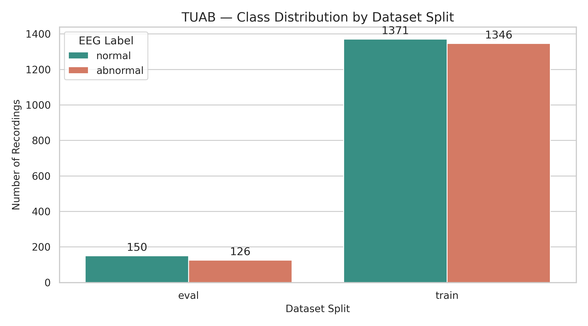
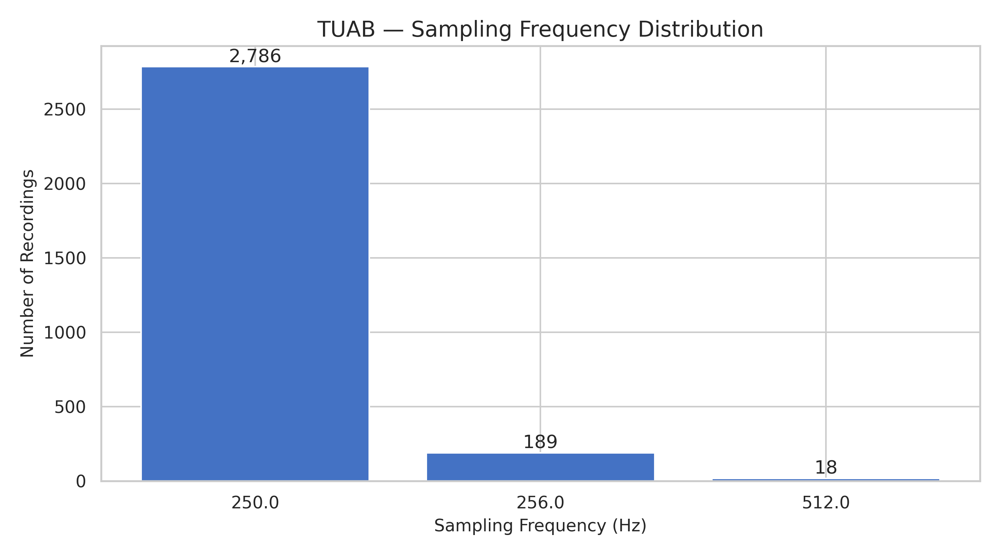
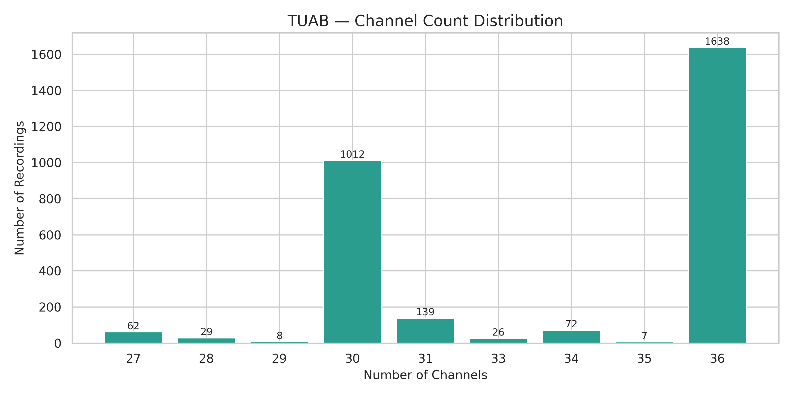
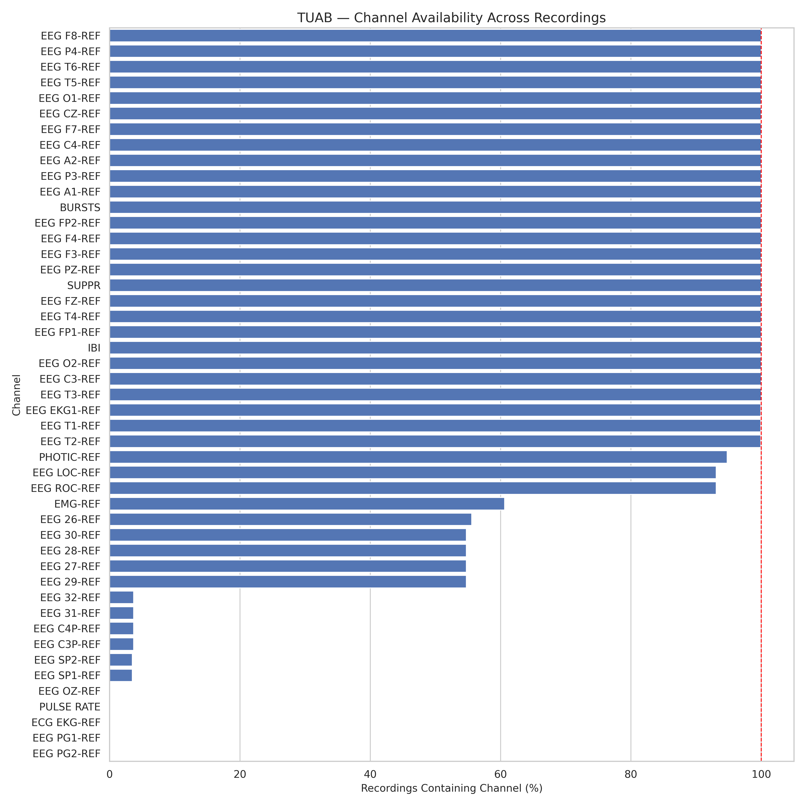
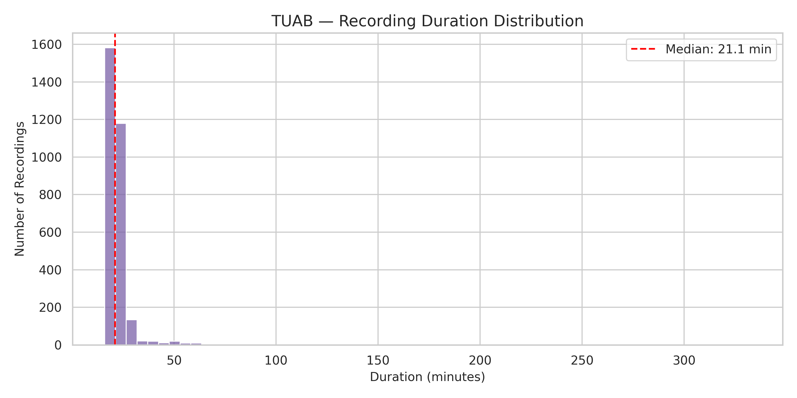
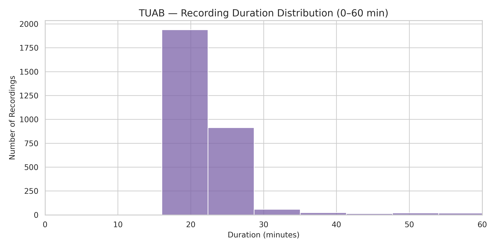
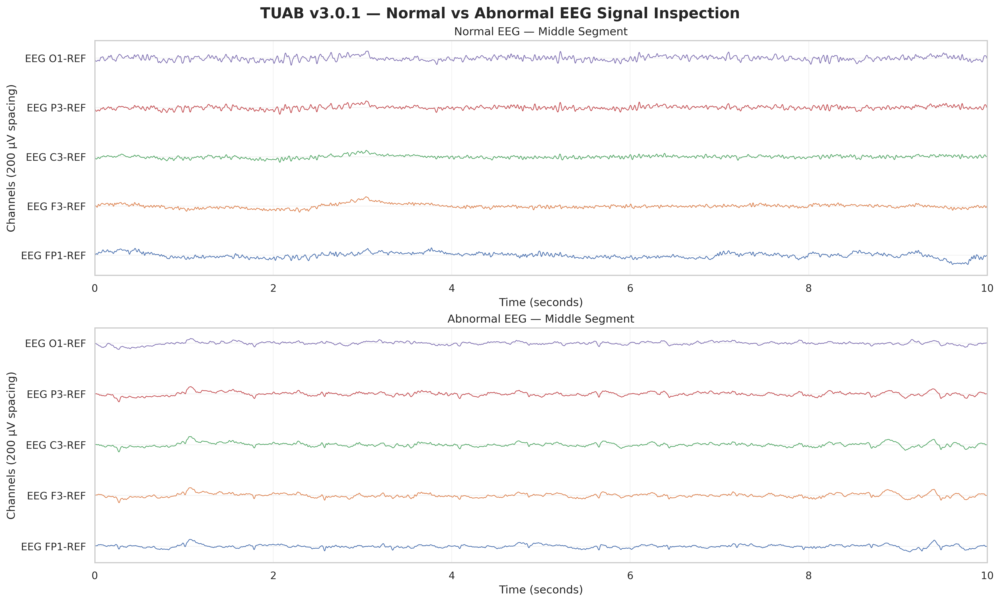
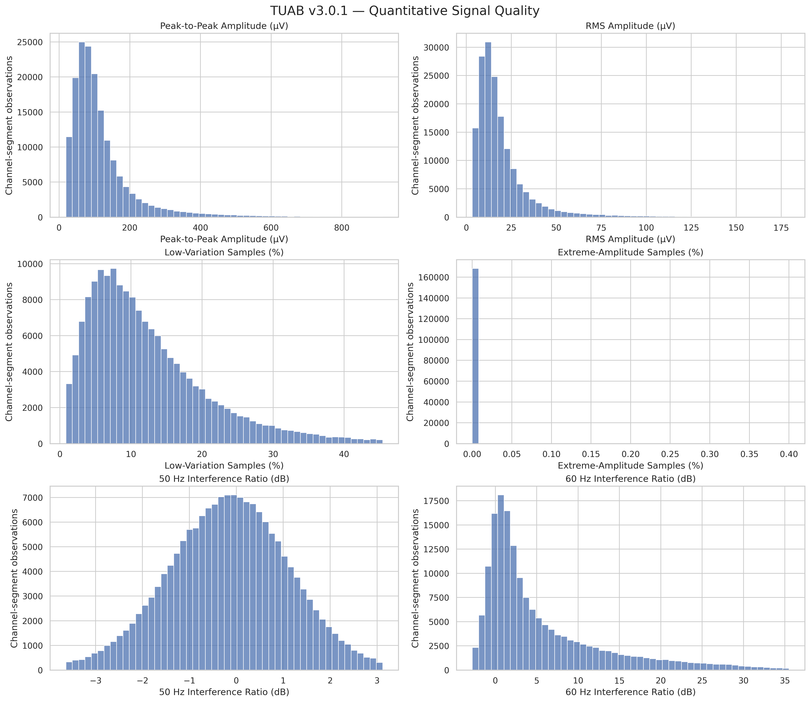
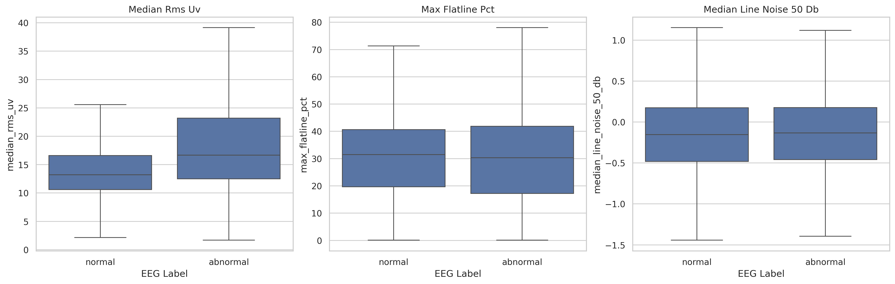

# TUAB Dataset Understanding and Signal-Quality Report

This report interprets the exploratory figures generated from the TUH Abnormal
EEG Corpus (TUAB) v3.0.1. Together, the figures describe 2,993 recordings and
motivate the preprocessing and evaluation decisions used by this project.

These are descriptive audit results. They do not establish that a visible
waveform difference is pathological, that a quality metric causes the class
label, or that a model will generalize to another clinical dataset.

## Summary of findings

| Finding | Evidence | Consequence for the study |
|---|---|---|
| The dataset is nearly class-balanced. | 1,521 normal and 1,472 abnormal recordings overall. | Accuracy is still insufficient on its own; report ROC-AUC, balanced accuracy, sensitivity, specificity, F1, and calibration. |
| Acquisition settings are heterogeneous. | Recordings use 250, 256, or 512 Hz and contain 27–36 channels. | Resample to one frequency and select a fixed ordered montage. |
| The required 19 scalp channels are available throughout the audited corpus. | All selected 10–20 channels reach the 100% availability line. | A consistent `(19, 1600)` CNN input is feasible after name standardization and resampling. |
| Recording lengths vary substantially. | Median duration is 21.1 minutes, with a sparse tail beyond 300 minutes. | Use fixed epochs and aggregate predictions by recording so long recordings do not become independent patients. |
| Amplitude distributions are strongly right-skewed. | Peak-to-peak and RMS histograms have long upper tails. | Do not treat high amplitude alone as proof of artifact; audit thresholds on training data. |
| Signal quality may differ by label. | Abnormal recordings have a higher and more variable median RMS amplitude. | Test for a quality-related label confound and run normalization/QC sensitivity analyses. |

## 1. Class distribution

### What the figure shows

- The official training split contains 1,371 normal and 1,346 abnormal
  recordings, or 2,717 recordings in total.
- The evaluation split contains 150 normal and 126 abnormal recordings, or 276
  recordings in total.
- Across both splits, there are 1,521 normal recordings (50.8%) and 1,472
  abnormal recordings (49.2%).
- The training set is very closely balanced. The evaluation set has a modestly
  larger normal proportion, but neither split exhibits severe class imbalance.

### Interpretation

The class distribution is favorable for binary classification and reduces the
need for aggressive class reweighting or resampling. Model selection must still
be patient-grouped, and evaluation should use class-sensitive metrics rather
than raw accuracy alone. This plot counts recordings, not unique patients or
epochs; those distributions must be audited separately.

## 2. Sampling-frequency distribution

### What the figure shows

- 2,786 recordings (93.1%) were acquired at 250 Hz.
- 189 recordings (6.3%) were acquired at 256 Hz.
- 18 recordings (0.6%) were acquired at 512 Hz.

### Interpretation

Most recordings share a common rate, but the corpus is not uniform. Feeding
the raw recordings directly to a model would produce inconsistent sample
counts and could allow acquisition frequency to become a shortcut feature.
Resampling every recording to the protocol's target rate of 200 Hz, with a
documented anti-alias filter, produces 1,600 samples per eight-second epoch.
The original sampling frequency should remain in the audit metadata so model
performance can be stratified by acquisition rate.

## 3. Channel-count distribution

### What the figure shows

| Channels | Recordings |
|---:|---:|
| 27 | 62 |
| 28 | 29 |
| 29 | 8 |
| 30 | 1,012 |
| 31 | 139 |
| 33 | 26 |
| 34 | 72 |
| 35 | 7 |
| 36 | 1,638 |

The dominant layouts contain 36 channels (54.7% of recordings) and 30 channels
(33.8%). The remaining recordings use several less common configurations.

### Interpretation

Total channel count cannot define the model input because it varies between
recordings and includes auxiliary or specialized channels. The pipeline should
select the same 19 scalp electrodes, normalize their names, verify their order,
and retain the unused channel inventory as metadata. Channel count may also
encode acquisition-system or site information, so it should be checked for
association with labels and model errors.

## 4. Channel availability

### What the figure shows

- The 19 scalp channels selected by the preprocessing protocol—Fp1, Fp2, F3,
  F4, F7, F8, Fz, C3, C4, Cz, T3, T4, T5, T6, P3, P4, Pz, O1, and O2—are
  present in all audited recordings under their TUAB `EEG ...-REF` names.
- Several recording-support channels are also universal, including A1/A2,
  EKG1, IBI, BURSTS, and SUPPR.
- PHOTIC, LOC, and ROC are nearly universal, whereas EMG and numbered auxiliary
  EEG channels occur only in subsets.
- A number of specialized channels are rare or absent.

### Interpretation

The figure supports a fixed 19-channel scalp montage without requiring routine
synthetic channel creation. It does not prove that every present channel is
usable: a channel can exist in the file while being flat, clipped, disconnected,
or severely corrupted. Availability and signal quality must therefore be
tracked separately. Auxiliary EOG/ECG/EMG-like channels should not enter the
primary model input, but their availability can assist artifact investigations.

## 5. Recording-duration distribution

### What the figure shows

- The median recording duration is 21.1 minutes.
- Most recordings are concentrated at relatively short clinical durations.
- The distribution is strongly right-skewed, with a small number of recordings
  extending beyond 60 minutes and isolated outliers beyond 300 minutes.

### Interpretation

Variable-length recordings require epoching before CNN training. They also
create a statistical weighting problem: a long recording yields many more
epochs than a short recording. Epochs from the same patient or recording must
never cross data partitions, and final predictions must be aggregated at the
recording level. Training should additionally consider recording-aware sampling
so a few very long studies do not dominate optimization.

## 6. Recording-duration detail: 0–60 minutes

### What the figure shows

The enlarged view confirms that the main mass lies around approximately 16–29
minutes. A much smaller number of recordings occupy the 29–60 minute range.
The two apparent concentrations likely reflect common clinical acquisition
durations or export conventions, although this plot alone cannot identify the
cause.

### Interpretation

Fixed eight-second windows are appropriate for constructing uniform examples,
but the pipeline must record incomplete discarded tails and the number of
retained epochs per recording. Any cap on epochs per recording should be chosen
using development data and documented, because it changes which portions of
long recordings contribute to learning.

## 7. Normal and abnormal signal inspection

### What the figure shows

- The plot presents one ten-second middle segment from one normal and one
  abnormal training recording.
- Five longitudinally distributed channels are shown: FP1, F3, C3, P3, and O1.
- Traces are filtered for visualization and vertically separated by 200 µV.
- The selected examples show visibly different temporal and amplitude patterns.

### Interpretation

This is a useful sanity check that EDF loading, channel selection, unit
conversion, filtering, and plotting work as intended. It is **not** evidence of
a general class-level morphology difference: only one recording per class was
selected, and the examples were not sampled to represent the population.
Clinical interpretation would require montage-aware review by a qualified EEG
reader. Population claims should come from prespecified quantitative analyses,
not this illustrative comparison.

## 8. Quantitative signal-quality distributions

### What the figure shows

The six panels summarize channel-segment observations sampled from the corpus:

- **Peak-to-peak amplitude:** strongly right-skewed, with most observations at
  moderate amplitudes and a long upper tail.
- **RMS amplitude:** also right-skewed, indicating substantial variability in
  typical signal magnitude.
- **Low-variation samples:** broadly distributed rather than concentrated at
  zero. This metric uses small adjacent-sample differences and should not be
  interpreted as confirmed electrode flatline without a sustained-duration
  rule.
- **Extreme-amplitude samples:** overwhelmingly close to zero under the chosen
  500 µV relative-to-median definition; extreme excursions are uncommon.
- **50 Hz interference ratio:** approximately centered near 0 dB.
- **60 Hz interference ratio:** asymmetric with a long positive tail, showing
  that frequency-specific interference varies between observations.

### Interpretation

The amplitude tails justify robust summaries and targeted inspection, but not
automatic rejection. High-amplitude pathological activity can be clinically
meaningful. Likewise, the line-noise panels show ratios relative to neighboring
frequency bands—not absolute proof that a segment is contaminated. Numerical
QC thresholds should be learned and validated on TUAB development-training
data, with suspicious epochs retained by default unless technical failure is
strongly supported.

## 9. Signal quality by class label

### What the figure shows

- Abnormal recordings have a higher median RMS amplitude and a wider RMS
  distribution than normal recordings.
- Maximum low-variation/flatline-like percentages overlap strongly between
  labels and have similar medians and ranges.
- Median 50 Hz interference ratios are nearly identical between labels.

### Interpretation

The RMS difference is a potential label confound. A classifier could exploit
amplitude or acquisition-quality differences rather than clinically meaningful
EEG morphology. The boxplot does not determine whether the difference arises
from pathology, medication, state, equipment, reference, demographics, or
artifact. The primary physical-unit baseline should therefore be compared with
training-derived robust scaling, and performance should be accompanied by
class-stratified QC and attribution analyses. The similarity in the other two
metrics is reassuring but does not exclude other quality confounders.

## Cross-figure conclusions

1. **Use a fixed 19-channel order.** Presence is consistent, while total channel
   count is not.
2. **Resample consistently.** The corpus contains three acquisition rates.
3. **Epoch without leaking groups.** Recording duration varies widely, so all
   epochs from one patient and recording must remain in one split.
4. **Evaluate at recording level.** Epoch counts differ because recording
   lengths differ; epoch-level scores would overstate the independent sample
   size.
5. **Preserve uncertain abnormal activity.** Amplitude outliers and unusual
   morphology are not automatically artifacts in clinical EEG.
6. **Audit preprocessing by label.** Rejection rate, retained duration, channel
   flags, amplitude metrics, and model errors should be reported separately for
   normal and abnormal recordings.
7. **Treat the RMS difference as a confound hypothesis.** Confirm it with
   patient-aware statistics and sensitivity experiments rather than assuming
   it represents pathology.

## Scope and limitations

- The figures summarize the audited TUAB release only and do not establish
  equivalence with NMT.
- Counts are recording-level unless a panel explicitly reports
  channel-segment observations.
- The figures do not show age, sex, site, device, medication, vigilance state,
  diagnosis, or patient-level distributions.
- Visual and signal-quality differences are descriptive; statistical testing
  must respect patient clustering and avoid using the held-out evaluation
  partition for protocol selection.
- Artifact thresholds and exclusion rules must be finalized on development
  data and frozen before official TUAB evaluation or NMT validation.

